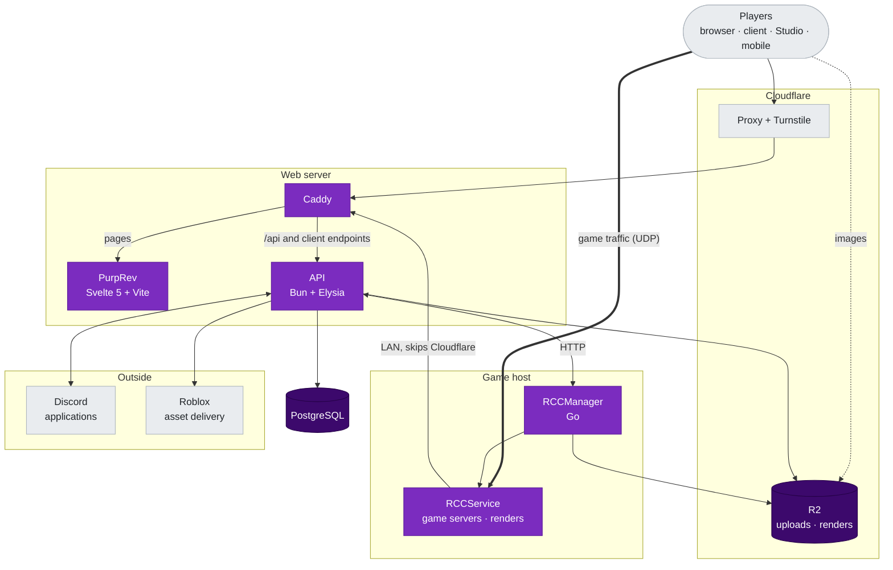

 

**A revival that goes for the win.**

## Infrastructure

## Services

| Service | Language | Purpose |
|---|---|---|
| **PurpRev** | TypeScript, Svelte 5 + Vite | Website frontend :3 |
| **PurpRev API** | TypeScript, Bun + Elysia | Backend for everything |
| **RCCManager** | Go | Start and stop game server, queue render. Will be open-sourced soon |
| **RCCService** | C++ | Runs game server and render avatar |

## Tech Stack

| Category | Technologies |
|---|---|
| **Languages** | TypeScript, Go, SQL |
| **Frontend** | Svelte 5, Vite, three.js for the 3D avatar |
| **Backend** | Bun, Elysia, OpenAPI docs from its plugin |
| **Database** | PostgreSQL 17 (in progress of migrating from MySQL) |
| **Storage** | Cloudflare R2 |
| **Reverse proxy** | Caddy |
| **External** | Roblox asset delivery, Discord, Cloudflare Turnstile |

## Infrastructure

| Provider | Purpose |
|---|---|
| **TBA** | TBA |
| **Cloudflare** | DNS, proxy, Turnstile, R2 for uploads and renders |
| **Caddy** | Reverse proxy and HTTPS |

### Backups

TBA

### Domain routing

| Domain | Goes to | Notes |
|---|---|---|
| `nonerev.de` | Caddy | Built frontend, and the API on `:3000` for `/api` and the client endpoints |
| `rev-cdn.mrrpmeowfurry.dev` | R2 | Uploads, thumbnails, place files |
| `rev-cdn.mrrpmeowfurry.dev/setup` | R2 | Launcher and client zips |
| WireGuard (internal) | Caddy | RCCManager and RCCService reach the API from an internal ip |
